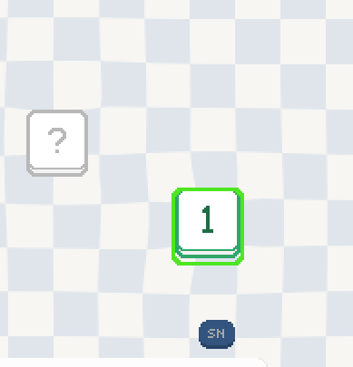

Consigne permanente : à chaque utilisation de ce fichier, suivre les demandes avec des cases `- [ ]` et les cocher `- [x]` dès que leur implémentation est terminée et vérifiée. Laisser décochée toute demande incomplète ou non vérifiée et conserver ce suivi dans le fichier, sans attendre un rappel.

- [x] Ajouter un mode backgorund fixe quand le background est affcihé pour empécher le deffilement du fond

- [x] Il y'a deja une var de difficulty il me semble qui modifie le hasard pour diminuer la chance de picoher trop de fois la carte jouable ce qui vient d'etre joué
Pour ajouter encore de la difficulté et tenté de restreeindre certaines stratégie moins fun, je voudrais diminuer la chance d'obtenir la valeur egale a ce qui vient d'etre joué. Sinon on peut jouer en "fille" en gardant toujours chacune des piles a une valeur égale.

Dans l'idée je veux forcé des écarts grandissants entre les différentes piles. Sans revenir a une stratégie ou l'on peu finir une pile sans avoir touché aux autres. Meme si au départ toute les piles reste à la même valeur. Si une autre stratégie de modification du hasard est pertinente. Fait en moi part.

Bien entendu il faut toujours que la main soit jouable (sauf en chall redraw) et continué d'adapté avec lucky hand

- [x] En tactile et en mode selection le bonus main collante est cassé.
Pour y remédier, quand une tuile est séléctionné en mode main collante ou commencé a etre drag, ajoute un hilight comme pour la selection mais de couleur verte.
Si la carte est laché en drag tactile elle reste la ou elle a été laché mais reste a nouveau selectionnable car la je n'arrive plus a la prendre
Et si en mode select on l'a touché/ clické on ne peut plus en selectionné d'autre avant qu'elle ne soit joué

- [x] ajoute une option dans le menu pour que le eju fasse une pause entre chaque niveau en attendant un clique ou touche du joeur avant de continuer (en restant fixe sur l'écran d'augmentation de la difficulté par exemple)

- [x]  Quand on déplace une carte main collante le higlight est décalé

- [x] const ADD_PILE_WEIGHT := 35.0
const ADD_CARD_WEIGHT := 12.0
const ADD_START_VALUE_WEIGHT := 25.0
const REDUCE_TURN_TIME_WEIGHT := 10.0

pour ces var lorsque diminue leur poids a mesure que l'on s'approche de leur v  aleur max